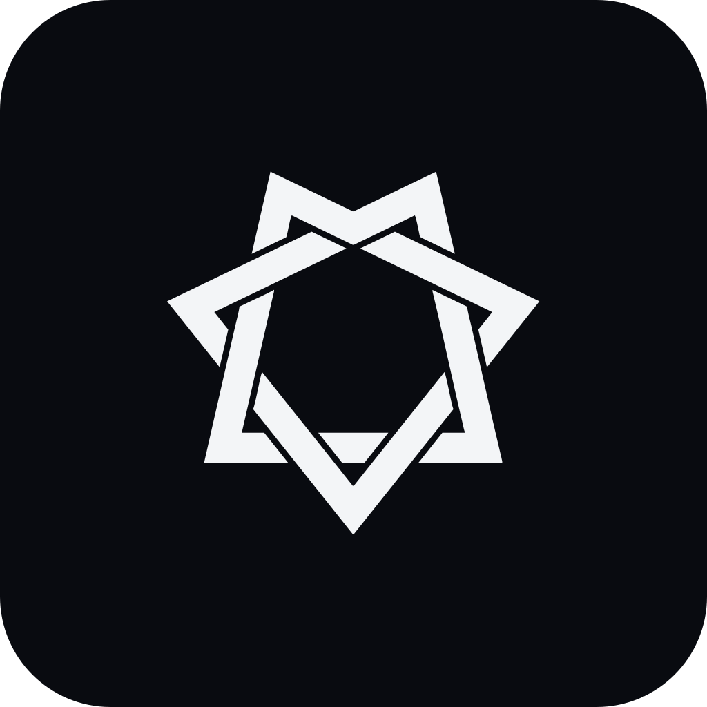
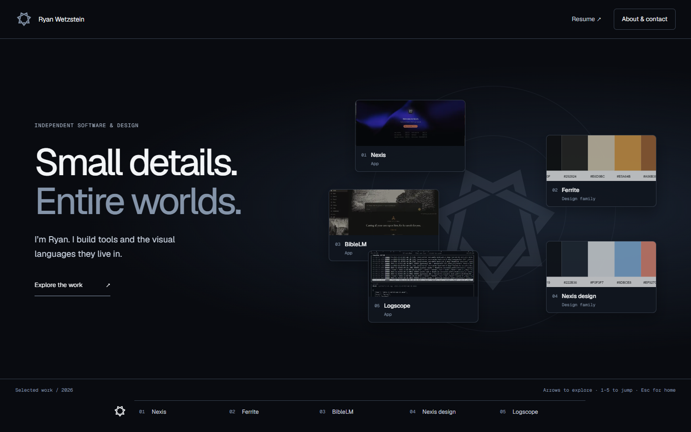

<p align="center">
  
</p>

<h1 align="center">Personal Website</h1>

<p align="center">
  Five projects, one viewport: Ryan Wetzstein’s software and design showcase in RAW Titanium.
</p>

<p align="center">
  <a href="https://github.com/rwetz/personal-website/actions/workflows/deploy.yml"></a>
</p>



Explore [ryanwetzstein.com](https://ryanwetzstein.com). The Stage alternates apps
and design families: Nexis, Ferrite, BibleLM, Nexis design, and Logscope. Each
project supplies its own palette and type; the header, rail and About modal stay
RAW Titanium.

## Features

- A Constellation intro with CSS depth, desktop pointer tilt, drift and real UI
  previews on intentional hover. Mobile gets a static tap-to-enter arrangement.
- Hash navigation and browser history that work on GitHub Pages without rewrites.
- A heptagram that morphs into project emblems, shared image transitions, and
  palette changes. Reduced motion disables the drift, tilt and morph.
- Real, silent app recordings with posters and pause controls. Videos pause in
  hidden tabs; reduced motion starts with a poster.
- Interactive Ferrite and Nexis design specimens with selectable accent swatches.
- About, experience, skills, resume and validated mailto contact in a focus-trapped
  modal. Experience data remains aligned with the existing resume.
- Lazy project scenes, a command palette, accessible tabs and screen-reader
  announcements. No Three.js or WebGL dependency.

## Keys

| Keys | Action |
|---|---|
| <kbd>←</kbd> <kbd>→</kbd> <kbd>↑</kbd> <kbd>↓</kbd> | Previous or next project |
| <kbd>1</kbd> through <kbd>5</kbd> | Jump to a project |
| <kbd>Esc</kbd> | Close a modal or return home |
| <kbd>Home</kbd> / <kbd>End</kbd> in the rail | First or last project |
| <kbd>Ctrl</kbd> + <kbd>K</kbd> / <kbd>⌘</kbd> + <kbd>K</kbd> | Command palette |

Horizontal swipes and debounced wheel gestures also navigate the Stage.
Shortcuts leave editable fields and open dialogs alone.

## Install

```sh
npm ci --ignore-scripts
npm run dev
```

Use Node.js 24 or newer. The site is React 19, Vite, Tailwind 4, Framer Motion,
GSAP and Radix UI. Fonts are bundled locally. The skill-logo stylesheet is
requested only when About opens, with its version and integrity pinned.

## Configuration

| Path | Purpose |
|---|---|
| `src/stage/projects.js` | Project order, copy, tags, palettes, links and posters |
| `src/stage/scenes/` | Lazy app recordings and design specimens |
| `src/stage/stage.css` | One-viewport layout, RAW Titanium chrome and responsive rules |
| `src/brand/` | Detailed heptagram and simple morph silhouettes |
| `src/components/Experience.jsx` | Resume-aligned experience data |
| `public/resume.pdf` | Downloadable resume |
| `docs/showcase-media.md` | Capture sources and playback behavior |
| `public/CNAME` | Production domain; do not change |

Project URLs use `#/nexis`, `#/ferrite`, `#/biblelm`, `#/nexis-design`, and
`#/logscope`. `#/` is home. Old `#nexis` bookmarks normalize to the local Stage.

## Development

```sh
npm run lint
npm run brand       # regenerate favicon, PNG icons and OG image
npm run thumbnails  # regenerate small intro images from real posters
npm run build
npm run test:e2e    # production preview, layouts, inputs, media and axe scans
npm run preview
```

The browser suite uses installed Edge on Windows. On other platforms install
Chromium once with `npx playwright install chromium`. Tests cover 360×640,
768×1024, 1440×900 and landscape 844×390, plus history, roving focus, swipe,
wheel, modal behavior, command navigation, real video decoding and reduced motion.

Pushing to `main` publishes through [GitHub Actions](.github/workflows/deploy.yml).
The workflow installs the lockfile, rejects high/critical dependency audit findings,
builds, lints, runs the browser/accessibility suite, and deploys `dist/` to GitHub
Pages. Documentation-only pushes are ignored. Generated build output stays untracked.

## License

This repository does not currently declare a project license. Dependencies retain
their own licenses; captured artwork retains its documented public-domain status.

---

<p align="center">
  <picture>
    <source media="(prefers-color-scheme: dark)" srcset="docs/brand/heptagram-white.svg">
    
  </picture>
</p>
